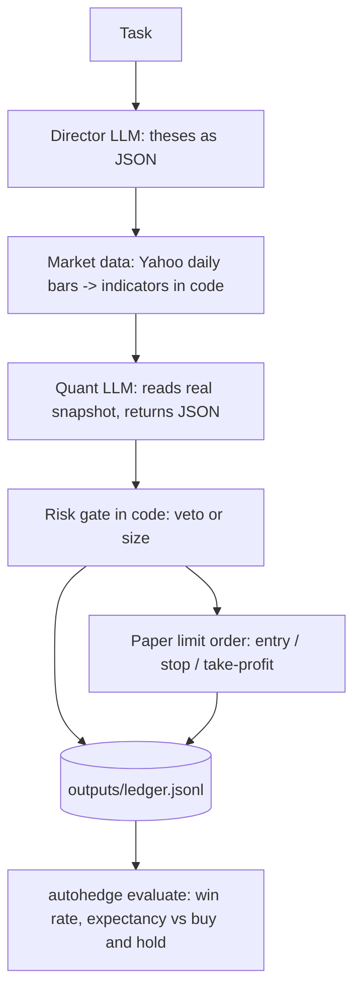

# AutoHedge

[](https://discord.gg/VapjxpSyHC3) [](https://www.youtube.com/@kyegomez3242) [](https://www.linkedin.com/in/kye-g-38759a207/) [](https://x.com/swarms_corp)


AutoHedge is an enterprise-grade autonomous agent hedge fund that trades on your behalf. It combines swarm intelligence and specialized AI agents to perform end-to-end market analysis, risk management, and execution with minimal human intervention.

**Current support:** Full autonomous trading on Solana. **Coming soon:** Coinbase and additional exchanges.

---

## Overview

AutoHedge is built to be the world's most powerful autonomous agent hedge fund. It runs continuous analysis, generates and validates trading theses, sizes risk, and executes orders across supported venues. The system is designed for institutional reliability: structured outputs, comprehensive logging, and a risk-first architecture that scales from single strategies to multi-venue, multi-asset deployment.

---

## Features

- **Multi-Agent Architecture**: Specialized agents for each stage of the trading pipeline
  - Director Agent: strategy and thesis generation
  - Quant Agent: technical and statistical analysis
  - Risk Management Agent: position sizing and risk assessment
  - Execution Agent: order generation and execution

- **Real-Time Market Analysis**: Integration with live market data for analysis and execution
- **Risk-First Design**: Built-in risk management and position sizing before any execution
- **Structured Output**: JSON-formatted recommendations and analysis for downstream systems
- **Enterprise Logging**: Detailed, configurable logging for audit and debugging
- **Extensible Framework**: Modular design for custom strategies and new venues

---

## Supported Venues

| Venue      | Status        | Notes                    |
|-----------|----------------|--------------------------|
| Solana    | Supported      | Full autonomous trading  |
| Coinbase  | Coming soon    | In development           |
| Other CEX | Roadmap        | Planned expansion        |

---

## Quick Start

### Installation

```bash
pip install -U autohedge
```

### Environment Variables

```bash
# LLM provider (one is enough; AUTOHEDGE_MODEL picks the model)
OPENAI_API_KEY=
ANTHROPIC_API_KEY=
AUTOHEDGE_MODEL=gpt-4.1

# Trading mode: only "paper" is supported
AUTOHEDGE_MODE=paper
AUTOHEDGE_EQUITY_USD=10000
```

See `.env.example` for a full reference. Risk limits can be overridden
with `AUTOHEDGE_<FIELD>` (e.g. `AUTOHEDGE_RISK_PER_TRADE_PCT=0.005`).

### Usage

```bash
autohedge                                  # interactive REPL
autohedge run "Analyze NVDA and SOL-USD"   # one task, prints a table
autohedge evaluate                         # score past recommendations
```

---

## Architecture

LLMs only produce opinions as validated JSON. Market data, risk,
sizing and orders are computed in code, in a fixed order:



### Risk gate (defaults)

| Rule | Default |
|---|---|
| Minimum Director conviction | 0.60 |
| Minimum Quant probability up | 0.55 |
| Maximum annualized 20-day volatility | 120% |
| Stop loss | 2 x ATR-14 below entry |
| Take profit | 2R above entry |
| Risk per trade | 1% of equity |
| Maximum position | 5% of equity |

Any failed rule vetoes the trade and is recorded with its reason.

### Paper trading and evaluation

Only paper trading is supported; any other `AUTOHEDGE_MODE` raises an
error. `autohedge evaluate` replays each approved recommendation
against later daily bars (limit fill, stop checked before
take-profit, 0.30% round-trip fees) and compares it with buy and hold
over the same window.

**Before considering real capital:** at least 30 resolved
recommendations, positive expectancy net of fees, average return above
buy and hold, and no single loss larger than the per-trade risk.

---

## Contributing

Contributions are welcome. See [Contributing Guidelines](CONTRIBUTING.md) for details.

1. Fork the repository
2. Create a feature branch (`git checkout -b feature/AmazingFeature`)
3. Commit changes (`git commit -m 'Add some AmazingFeature'`)
4. Push to the branch (`git push origin feature/AmazingFeature`)
5. Open a Pull Request

---

## License

MIT License. See [LICENSE](LICENSE) for details.

---

## Acknowledgments

- [Swarms](https://swarms.ai) for the AI agent framework

---

## Support

- Issue Tracker: [GitHub Issues](https://github.com/The-Swarm-Corporation/AutoHedge/issues)
- Community: [Discord](https://swarms.ai)

---

AutoHedge by [The Swarm Corporation](https://github.com/The-Swarm-Corporation)
